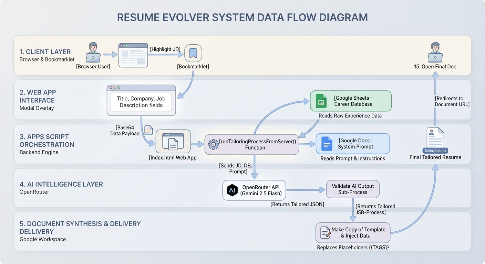

# REvolver - Resume Evolver 🎯

REvolver is a serverless AI resume tailoring tool built within the Google Ecosystem. It utilizes a **Google Sheet** database, **Google Docs** templates, **Google Apps Script** execution, and **OpenRouter**.

## Architecture

## Setup & Configuration

### 1. Career Database (Google Sheets)

* Create a sheet with the first tab named **`Database`**.

* Set up row headers in Row 1 corresponding to your tracking needs (e.g., `Item`, `Name`, `Description`, `Technology used`, `Skills applicable`, `Link`, `Role / Context`, `Duplicate Group`).

* Map item types in the **`Item`** column: `Exp` (work history), `prj` (projects), `Crt` (certifications), `skills` (skill categories), and `por` (positions of responsibility).

### 2. Google Doc Template

Create a template document using placeholder tags defined in `TEMPLATE_TAGS` inside `Code.js`:

* **Summary/Metadata:** `{{SUMMARY}}`, `{{SKILLS}}`, `{{COMPANY}}`, `{{JOB_TITLE}}`

* **Skill Groups (1 to 8):** `{{SKILL_GROUP_%d_TITLE}}`, `{{SKILL_GROUP_%d_SKILLS}}`

* **Experiences (1 to 3):** `{{EXP_%d_ROLE}}`, `{{EXP_%d_COMPANY}}`, `{{EXP_%d_DATES}}`, `{{EXP_%d_LOCATION}}`, `{{EXP_%d_BULLET_%b}}`

* **Projects (1 to 3):** `{{PROJECT_%d_TITLE}}`, `{{PROJECT_%d_TECH}}`, `{{PROJECT_%d_LINK}}`, `{{PROJECT_%d_BULLET_%b}}`

* **Certifications (1 to 4):** `{{CERT_%d_TITLE}}`, `{{CERT_%d_ORG}}`, `{{CERT_%d_DATE}}`

* **Responsibilities (1 to 3):** `{{POR_%d_ROLE}}`, `{{POR_%d_ORG}}`, `{{POR_%d_DATES}}`, `{{POR_%d_BULLET_%b}}`

Note: Unused placeholder blocks and associated formatting are automatically deleted if the AI selects fewer entries.

### 3. Google Apps Script Deployment

1. Open your Career Database sheet and click **Extensions > Apps Script**.

2. Paste `Code.js` into the script editor and create an HTML file named `Index` containing `Index.html`.

3. Add the following keys under **Project Settings > Script properties**:

* `OPENROUTER_API_KEY`

* `OPENROUTER_MODEL` (Default: `google/gemini-2.5-flash`)

* `SPREADSHEET_ID`

* `TEMPLATE_DOC_ID`

* `OUTPUT_FOLDER_ID`

* `PROMPT_DOC_ID`

4. Click **Deploy > New deployment**:

* **Type:** Web App

* **Execute as:** `Me`

* **Who has access:** `Anyone`

5. Copy the generated **Web App URL**.

### 4. Bookmarklet Installation

1. Insert your deployed Web App URL into `bookmarklet.js`.

2. Minify the script manually or using `python3 scripts/minify_bookmarklet.py`.

3. Create a new browser bookmark with the name `Tailor Resume` and paste the minified `javascript:...` payload as the URL.

## Usage

1. Highlight a job description on any web page.

2. Click the **Tailor Resume** bookmarklet.

3. Verify or adjust the company name, job title, and pre-filled description in the modal overlay, then submit.

4. The system executes server-side parsing, queries OpenRouter, populates the Google Doc template, and automatically redirects your tab to the generated document in Google Drive.